# Architecture

This is a local reference-to-inspection application. The operator supplies a known-good PCB image, confirms its geometry and expected component regions, and inspects photographs or browser camera frames of the same design. FastAPI runs the alignment, compatibility and comparison pipeline on the laptop; React presents the evidence and operator review workflow. Thresholds and defect accuracy remain provisional.



The diagram follows the upload-to-review path. Its arrows show local HTTP at the browser boundary and logical in-process data handoffs between backend responsibilities. The compatibility gate also performs an early supported-catalog mismatch check before the alignment slice shown in the main path. A blocked or unverified photo reaches reporting without component verdicts. The existing Parsa component model is attempted after verification; handled checkpoint/detection unavailability is recorded and the expected-region comparison can continue.

- [Open the interactive Archify diagram](docs/architecture/inspection-architecture.html) — inspect source citations and component explanations.
- [Editable architecture JSON](docs/architecture/candidate.json) — the authored input, using Archify automatic layout.
- [Exported SVG](docs/architecture/inspection-architecture.svg) — local relative image embedded above.
- [Finalization summary](docs/architecture/inspection-architecture.finalize-summary.json) and [full receipt](docs/architecture/inspection-architecture.finalize.json).
- [Visual evidence contact sheet](docs/architecture/visual-check/inspection-architecture.visual-check.html).

## Runtime responsibilities

| Responsibility | Implementation |
| --- | --- |
| Browser application | `frontend/src/PlatformApp.jsx` wraps the inspection lab in `main.jsx`; platform pages provide dashboard, golden library, live inspection, account settings and access management. `Comparison.jsx` presents overlays and paired component crops. |
| Local API and input boundary | `pcb_landmarks/web.py::create_app` accepts JPEG/PNG uploads, validates limits and IDs, snapshots the request configuration, processes each photo independently and serves built `frontend/dist` assets. |
| Reference setup | The operator can correct the four ordered points and separate convex PCB surface outline. Confirmed geometry is stored in `reference.json`; expected component rectangles are captured in the request and saved golden configuration. Image proposals and explicit imported component maps remain reviewable. |
| Landmark and registration paths | `infer.py` uses the configured local pose checkpoint. In saved-reference automatic mode, `registration.py` verifies pose transforms with reciprocal on-board SIFT matches and can fall back to reference-feature RANSAC registration. Manual points use `align.py`, with independent manual refinement when supported. Projected points are labeled separately from detections. |
| Compatibility and acceptance to scoring | `compatibility.py` checks supported-layout evidence; `registration.verify_alignment` checks distributed/held-out reprojection, PCB overlap and stable edges. `web.py` requires `SAME_DESIGN` before comparison. Four fitted points alone are insufficient evidence. |
| Expected component comparison | `compare.py` consumes saved reference-grid regions, aligned inspection pixels and mask. Bounded Sobel matching, optional symmetric sharpening, corroborated absence and displacement/rotation rules produce `present`, `missing`, `misaligned` or `uncertain`; blocked work is `not_evaluated`. |
| Existing component evidence | `component_detection.py`, `component_model.py` and `parsa_tiling.py` use the existing ParsaVictor YOLO26 locator when its local checkpoint is usable. `correspondence.py` transforms and assigns detections uniquely. Such evidence supports or conflicts with region decisions; a detection alone does not establish presence. |
| Reporting and review | FastAPI writes available alignment/component/difference PNGs and batch JSON. `platform_store.py` stores inspection summaries and separate operator review decisions transactionally in SQLite. `simulator.py` and camera-frame routes reuse inspection against a selected golden reference. |

The application is designed for offline runtime after online dependency/model preparation and frontend build. No external inference service is required. This describes source behavior, not proof of a full target-machine network-isolated acceptance run. Loopback origin/host and validation checks coexist with role checks on platform operations; the inspection lab is not claimed as a production authentication boundary.

## Coordinates, results and persistence

Coordinates refer to original decoded image pixels. Non-normalized EXIF orientation is rejected. Rectangles are integer, half-open `[x1,y1,x2,y2]`; browser zoom changes display only. Inspection images are warped into the reference pixel grid with a full-source-support mask. Local match search does not move the saved rectangle.

The lab API accepts 1–15 inspection photos and 1–1000 component entries. Each upload is at most 12 MiB, with decoded dimensions at least 2×2 and at most 20 million pixels. Valid comparison boxes have a minimum side of 5 pixels. Sharpening defaults off and, when enabled, uses identical mild unsharp parameters on both grayscale comparison inputs.

Photo outcomes are `ok`, `defect`, `review`, `error` and `DIFFERENT_BOARD`. A missing or misaligned part yields `defect` and requires review, while retaining uncertain rows. Reports also carry photo classifications such as `GOOD`, `MISSING_COMPONENT`, `MISALIGNED_COMPONENT`, `NEEDS_REVIEW` and `BOARD_MISMATCH`. These fields differ from the original baseline's proposed `missing` and `retake` photo outcomes; see the [SRS result contract](docs/specs/SRS.md#3-terms-and-result-rules).

Default persistent storage is under `runs/web`, configurable with `PCB_WEB_STORAGE`:

| Path | Content / owner |
| --- | --- |
| `photos/<uuid>/image.png`, `photo.json` | FastAPI-owned decoded reference/inspection pixels and metadata |
| `photos/<uuid>/reference.json` | Confirmed points and outline, saved by atomic temporary-file replacement |
| `batches/<uuid>/report.json`, `<index>/*.png` | Captured annotations/options/configuration, per-photo results and available overlays written by API orchestration |
| `aoi.db` | SQLite users/sessions, preferences, golden configuration/library, inspection summaries and explicit review decisions managed by `AOIStore` |

Reference geometry JSON, golden component configuration in SQLite, and evidence images are separate operations. The system does not provide a single transaction for all artifacts or guaranteed complete per-run model hashes. Configuration/model files are local inputs, not new runtime services.

## Source pin and generated artifact checks

Archify verified **24 source ranges** against repository [IndustryAI_Project](https://github.com/DataDetective-Neel/IndustryAI_Project) at commit [`3c3de5425be6803e4765bbb8b91b0776893f3a30`](https://github.com/DataDetective-Neel/IndustryAI_Project/tree/3c3de5425be6803e4765bbb8b91b0776893f3a30). Each diagram component carries exact repository-relative ranges. The working tree also contains submission documentation/dataset/setup edits; those uncommitted files are not represented as committed source evidence. Runtime source cited by the diagram was unchanged by this documentation task.

The generated HTML passed Archify `validate`, `deliver`, strict provenance `check` and real-browser `browser-check` at showcase quality. A separate `visual-check` captured light/dark views at 1440×900 and 2048×1320, passing containment, readability and viewer checks. The 1440×900 light capture was visually inspected: the main path, compatibility bypass, optional evidence branch, persistence outputs and API return can be followed. Automated capture receipts themselves retain `visualReview: pending`; the image inspection described here is a separate documentation review. No application tests, model accuracy evaluation or offline restart were performed as part of these diagram checks.

Archify was installed for Codex in this project only, following its [official instructions](https://raw.githubusercontent.com/tt-a1i/archify/main/llms.txt). Discovery listed exactly one `archify` skill; the installed package's `doctor` check passed. Tooling under `.agents/` is ignored and is not an application runtime dependency. To reproduce the installation, first inspect any existing destination and preserve unmanaged files:

```powershell
npx -y skills@latest add https://archify.si --list --full-depth
npx -y skills@latest add https://archify.si --skill archify --agent codex --copy --yes
node .agents/skills/archify/bin/archify.mjs doctor
```

To regenerate from this repository root, with the project-local Archify skill installed:

```powershell
$env:ARCHIFY_UPDATE_CHECK_DISABLED = '1'
node .agents/skills/archify/bin/archify.mjs finalize architecture docs/architecture/candidate.json docs/architecture/inspection-architecture.html --repo-root . --quality showcase --json --out-dir docs/architecture/regenerated-check
node .agents/skills/archify/bin/export-svg.mjs docs/architecture/inspection-architecture.html docs/architecture/inspection-architecture.svg light
```

The JSON pins a specific commit; update and re-audit its source references intentionally when documenting a later revision. Archify diagram checks validate the artifact and pinned references, not the application's inspection accuracy.

## Remaining acceptance limits

The pose configuration records narrow mounting-hole training/calibration scope; the compatibility catalog covers supported layouts. Colored-surface isolation, weak texture, repeated features, glare, occlusion, parallax and large viewpoint changes can require review. The provisional comparator has synthetic and regression fixtures; these do not establish accuracy on real defective boards or arbitrary unseen layouts. Broad threshold calibration, controlled sharpening ablation, comprehensive global quality gates and target-laptop latency/memory/offline acceptance remain bounded future verification work.

See [SRS traceability](docs/specs/SRS.md#41-source-audited-traceability), [detailed design](docs/specs/SDD.md), [data flow diagrams](docs/specs/DFD.md), [documentation index](docs/README.md) and the [project README](README.md) for requirements, historical evidence and launch instructions.
