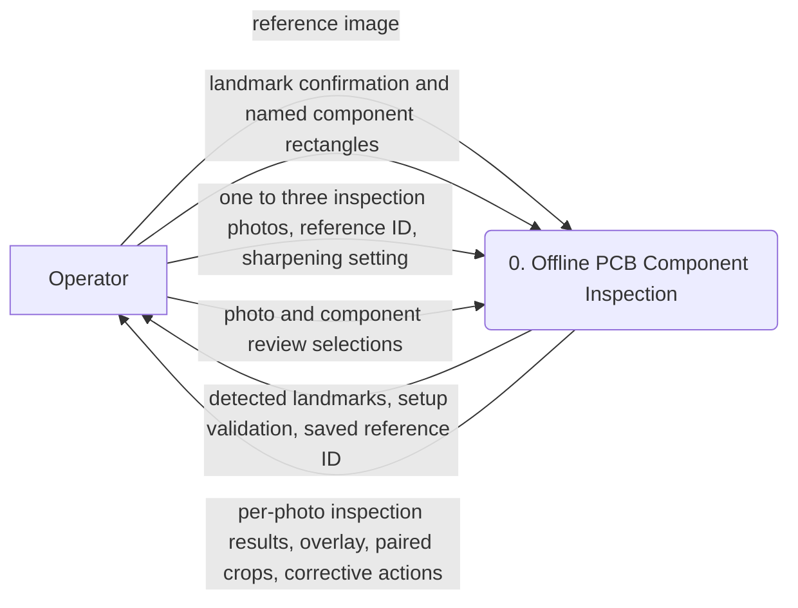
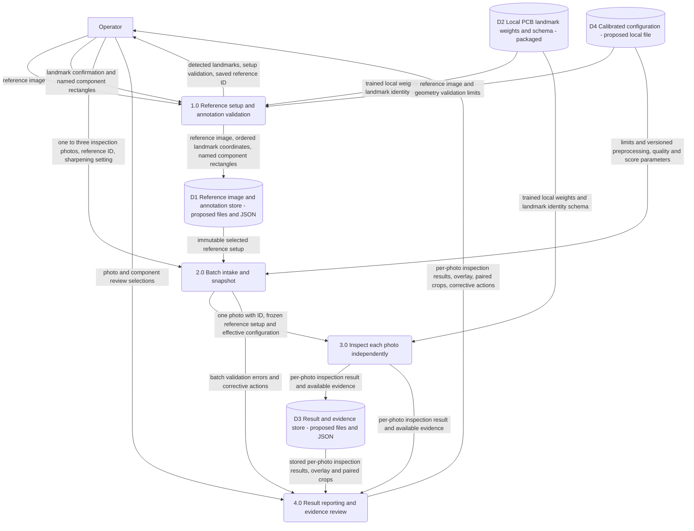
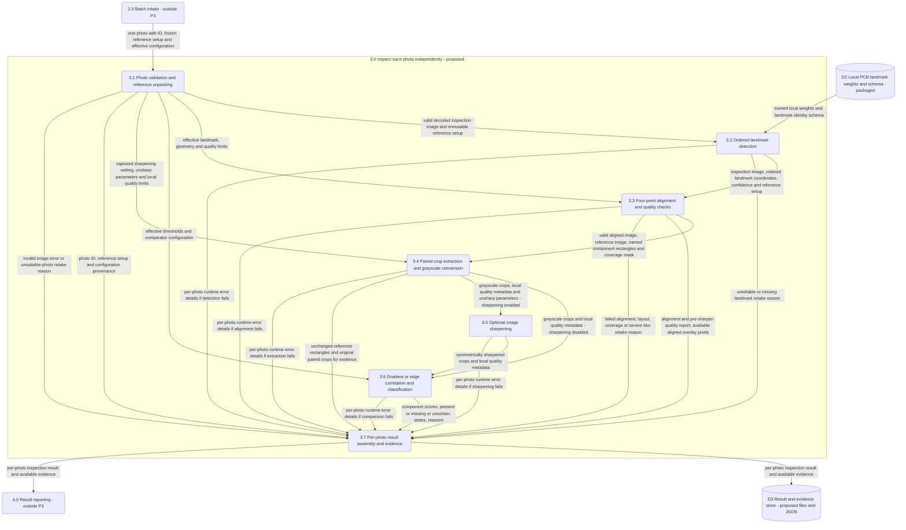

# Data Flow Diagrams

- **Project:** Offline PCB Component Inspection — Task B, “Which Part Is Missing?”
- **Author:** Indraneel Chatterjee
- **Version:** 1.0 — 20 November 2026
- **Status:** Proposed data flows, not an implemented system.

Related documents: [Software Requirements Specification](SRS.md) · [Software Design Document](SDD.md).

Implementation update: [Step 3](STEP3.md) implements offline landmark training,
evaluation and a local detector entry point; [measured accuracy](STEP3_RESULTS.md)
failed readiness. [Step 4](STEP4.md) implements the four-point warp, validity mask
and review overlay from reviewed Step 2 labels. The complete application flows
and automated quality/acceptance gates below remain proposed.

## 1. Notation and shared contract

These are logical DFDs expressed with Mermaid flowchart shapes. Rectangles represent **external entities**; rounded nodes represent **processes**; cylinders represent **data stores**. Every arrow names the data transferred, including settings that select preprocessing. Numbers identify processes, not execution timing. Mermaid rendering follows [GitHub's fenced diagram support](https://docs.github.com/en/get-started/writing-on-github/working-with-advanced-formatting/creating-diagrams) and the [Mermaid flowchart syntax](https://mermaid.js.org/syntax/flowchart.html).

The only runtime human actor is the operator. Training and online packaging occur before this runtime boundary; packaged local model weights and calibrated configuration are internal read-only inputs, not a cloud service. No external network entity participates in inspection.

All levels use the same contract:

- One known-good reference image, four confirmed ordered landmarks, and at least one named component rectangle form a saved setup.
- A batch contains **one to three inspection photos**, one reference setup ID, and one captured sharpening enabled/disabled setting. Each accepted photo yields its own result, including failures.
- Landmarks and rectangles use the full-resolution, decoded orientation-normalized reference's original pixel frame. Rectangle bounds are integer half-open `[x1,y1,x2,y2]`; zoom affects display only. Alignment warps inspection pixels into that frame, never the stored rectangles.
- Sharpening is optional and symmetric on the pair of grayscale crops, after alignment/extraction and before comparison; bypass goes directly to comparison without changing coordinates or crop sizes. Parameters and the eventual default are TBD pending paired validation.
- `error` means processing failed; `retake` means layout/alignment/global quality is unsuitable. After gates pass, any confirmed missing part yields `missing` (preserving uncertain parts and `review_required`); otherwise uncertainty yields `review`; otherwise all saved parts present yields green `ok`. Failed gates have no valid part verdicts and no OK. See [SRS result rules](SRS.md#3-terms-and-result-rules).

Proposed stores: **D1** reference images and JSON annotations; **D2** local trained weights plus model/schema manifest; **D3** result metadata and local overlay/crop files; **D4** calibrated configuration. File/JSON storage, paths, retention and numeric settings are proposals; no database or persisted assets exist yet. Draft reference staging is internal to reference setup and omitted as a separate logical store.

## 2. Level 0 — context

The system receives operator-supplied images, confirmed setup data and inspection/review selections, and returns setup feedback and per-photo inspection evidence. It never claims OK for an unusable image or an unmarked board.

## 3. Level 1 — system decomposition

**P1** validates/stages a reference, detects its landmarks, accepts operator confirmation and edited annotations, and writes a complete immutable setup to D1. **P2** validates batch framing/count/options and captures the chosen setup and configuration. **P3** processes each accepted photo independently. **P4** exposes stored results and the selected overlay/crops. D2 and D4 are supplied locally during pre-demo packaging; runtime reads do not download them.

No data moves directly between the operator and a store. D1 is read through P2 and included in the immutable work item sent to P3; P3 does not silently re-read a changed active setup. The model is a landmark detector, while crop comparison classifies apparent component presence. Reference confirmations and image validation errors are refinements of the same Level 0 boundary flows.

## 4. Level 2 — decomposition of P3 inspection

The boundary is one photo plus its frozen reference/configuration from P2, local weights/schema from D2, and the per-photo result/evidence sent to both D3 and P4. P2 remains responsible for batch count and snapshot capture; this diagram does not introduce a new operator upload path.

### 4.1 Process notes

- **3.1 Validation:** validate file content/decoding, limits and gross quality, unpack the captured reference image/landmarks/rectangles and configuration, and preserve identity for any failure result. Error and retake routes are alternatives to the normal path, not simultaneous successful inspections.
- **3.2 Landmarks:** load/reuse the packaged PCB-specific model and return four semantic landmark identities in the schema's fixed order, in inspection-image pixel coordinates. Do not infer identity by sorting screen positions. Landmark detection is also used internally during reference setup in Level 1 P1.
- **3.3 Alignment/quality:** use inspection-to-reference `getPerspectiveTransform` and `warpPerspective`, validate confidence, geometry, marked-region coverage and original image quality, and check independent stable board features where available. An exact four-point fit is not independent alignment evidence. The reference image and rectangles pass through unchanged. Unverified alignment or severe blur yields retake before comparison.
- **3.4 Crops:** slice both images at the saved reference-coordinate rectangles, convert to grayscale, and preserve the original evidence and local quality metadata. Route each crop pair through exactly one preprocessing path according to the captured batch option.
- **3.5 Optional sharpening:** apply the same mild unsharp parameters to both grayscale crops, retaining shape and reference coordinates. The disabled arrow from 3.4 to 3.6 is the explicit bypass. Sharpening cannot change the pre-sharpen quality decision.
- **3.6 Comparison:** derive edges/gradients from its incoming pair on either path; apply normalized correlation and calibrated thresholds. Local poor quality or uninformative/nonfinite scores become uncertain. Exact thresholds and representation are TBD.
- **3.7 Assembly:** apply [SRS outcome precedence](SRS.md#3-terms-and-result-rules), retain missing findings alongside uncertainty, and return names, rectangles, reasons, provenance and available evidence. Failure results have no valid component verdicts. A runtime failure in any stage is caught by the per-photo orchestrator; result assembly/reporting handles a minimal error result if full evidence generation fails. Other batch photos continue.

### 4.2 Boundary balancing and cross-document checks

| Parent flow | Child flows / preservation |
| --- | --- |
| Level 0 operator → system: reference and confirmed setup data | Level 1 operator → P1; P1 → D1 stores the complete validated setup |
| Level 0 system → operator: setup feedback | Level 1 P1 → operator, including detection, rejection and saved reference ID |
| Level 0 operator → system: batch files, reference ID, sharpening setting | Level 1 operator → P2; P2 → P3 carries one work item per input plus the captured reference/configuration |
| Level 0 operator → system: review selections | Level 1 operator → P4; selected evidence is read from D3 |
| Level 0 system → operator: results/evidence/corrective actions | Level 1 P4 → operator; P2 validation failures and P3 per-photo results both reach P4 |
| Level 1 P2 → P3: photo, frozen setup/configuration | Level 2 P2 → 3.1; the setup includes reference image, ordered landmarks, named rectangles and original dimensions |
| Level 1 D2 → P3: weights/schema | Level 2 D2 → 3.2; D4 configuration already arrives through P2, not a new boundary input |
| Level 1 P3 → D3 and P4: result/evidence | Level 2 3.7 → D3 and P4, including error/retake results and nullable evidence |

Upload counts, coordinate semantics, optional-sharpening behavior, outcome rules and offline operation are defined in the [SRS](SRS.md) and detailed in the [SDD](SDD.md). Model training, threshold tuning and sharpening ablation occur before deployment and do not add runtime external entities. Diagram validation does not establish model accuracy or application acceptance.
