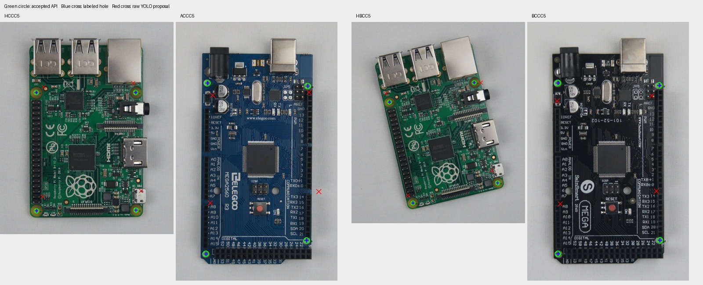

# Mounting-hole correction for the pictured layouts

## Confirmed cause

The screenshots correspond to the repository's HCCC5, ACCC5, HBCC5 and BCCC5
photos. The intended, present and loadable checkpoint is
`models/pcb-mounting-holes-yolo26n-pose.pt`, SHA-256
`a3035f835ff92d57b452f7c43edf566cf83e50b9752623b00e044e4ee6d773a3`.
Its resolved runtime path is `A:\IndustryAI_Project\models\pcb-mounting-holes-yolo26n-pose.pt`.
The checkpoint is a YOLO26 pose model: one `pcb` class with four `(x,y,confidence)`
keypoints, ordered upper-left, upper-right, lower-right, lower-left.

Those weights and their gold-rim/orientation verifier were fine-tuned for the M
Raspberry Pi layout. The pictured H Pi has a different upper connector arrangement;
the A/B Mega boards have bare, silver-gray mounting holes. The raw proposals miss
holes, and the single M layout fingerprint rejects H images. This was not a
frontend scaling, keypoint/class-map, EXIF, or letterbox reversal error. The app
correctly rejected most of these predictions, but drew the rejected raw guesses
as tentative points, which made their inaccuracy prominent.

## Change

YOLO26 still runs on the exact decoded/uploaded pixels and its raw outputs remain
in diagnostics. **No weights were retrained or replaced.** For the known A/B/H
layouts, the pipeline now offers an explicit `calibrated_layout_mounts` correction:

1. Reuse the distributed SIFT/RANSAC layout evidence already used for board
   compatibility. Masks exclude surrounding cloth and the central Mega target IC.
2. Project the saved, labeled mounting-hole coordinates into the uploaded raster.
3. Rectify locally and verify each hole in a bounded search (0.8% of the template's
   smaller dimension). Require normalized patch correlation >= 0.65 and gradient
   correlation >= 0.4, complete valid-pixel coverage, and an interior search maximum.
   A circular mask excludes adjacent raised components. Colored boards use
   saturation to reduce cloth texture and shadow effects; the black board uses gray.
4. Accept all four verified points in their calibrated identities or return failure
   for manual correction. Calibration scores are not YOLO probabilities, so corrected
   points have `confidence: null` and a separate source/evidence record.

Pi H/M profiles also require positive agreement in their distinct upper connector
regions after distributed matching. Otherwise shared lower-board features could
confuse the designs. Frontal and perspective calibration views share canonical
coordinates, preserving the independent inspection-to-reference alignment check.

Calibration inputs are A: ACCC5; B: BCCC5; H: HCCC5/HCCB5. M compatibility uses
MCCB5/MBCC5 and retains its existing YOLO/rim/orientation method. These are a small,
known-board demo calibration, not a new generalized landmark model. Several test
photos are calibration inputs; the other views and generated warp are controls,
not an independent accuracy benchmark.

The UI displays only accepted automatic points. Rejected proposals remain in raw
diagnostics; Manual correction is still available. The production server was
restarted to load the new configuration and calibration views.

## Direct inference versus uploaded inference

All 19 tested photos returned identical points through direct inference and
`POST /api/photos` → `POST /api/landmarks/{id}`. Uploads used anonymous filenames.
Maximum Euclidean error against the existing labeled centers, in original pixels:

| Screenshot source | Raw YOLO max error | Accepted app max error |
| --- | ---: | ---: |
| HCCC5, Pi front | 144.11 px | 0.52 px |
| ACCC5, blue Mega | 302.78 px | 0.50 px |
| HBCC5, rotated Pi | 102.06 px | 1.00 px |
| BCCC5, black Mega | 295.85 px | 0.58 px |

The [machine-readable evidence](results/mount-calibration.json) records every raw
landmark ID, confidence and coordinate, final points, errors, local verification,
model rejection reason, checkpoint hash, and inspection outcomes.

## Regression results

| Test | Result |
| --- | --- |
| Four screenshot layouts through production UI | PASS: four accepted points on labeled holes |
| A: identical plus all four angle variants | PASS: landmarks accepted; max error 3.68 px |
| H: front plus all four angle variants | PASS: landmarks accepted; max error 2.40 px |
| Original four M views | PASS: landmarks accepted; max error 6.18 px |
| B: front and two rotated views | PASS: accepted; max error 0.58 px |
| BCCB5 / BCDC5 black-board perspective views | REVIEW: local hole patches not verified; no automatic markers |
| Automatic A/H angle inspection, eight images | PASS: SAME_DESIGN, target IC PRESENT, zero false MISSING |
| ACCC5 versus MBCC5 | PASS: DIFFERENT_BOARD, required message, no component decisions |
| Simulated processor erasure | PASS: still reaches component inspection, REVIEW rather than DIFFERENT_BOARD |
| Erased mounting hole, blur and half-crop | PASS: rejected rather than invented points |
| New mild perspective warp, A/H | PASS: hole and independent interior-control error < 4 px |

The generated-warp regression saves its explicit transform in
`tests/test_calibrated_mounts.py`; it checks three interior features beyond the
four fitted mounting holes. No real missing-component accuracy claim is made.

Reproduce with `python -m unittest discover -s tests` in the repository environment,
then `npm test` and `npm run test:browser` in `frontend`.

Final checks: **60 backend tests, 4 frontend unit tests, 12 browser tests passed**;
production build and `git diff --check` passed.
