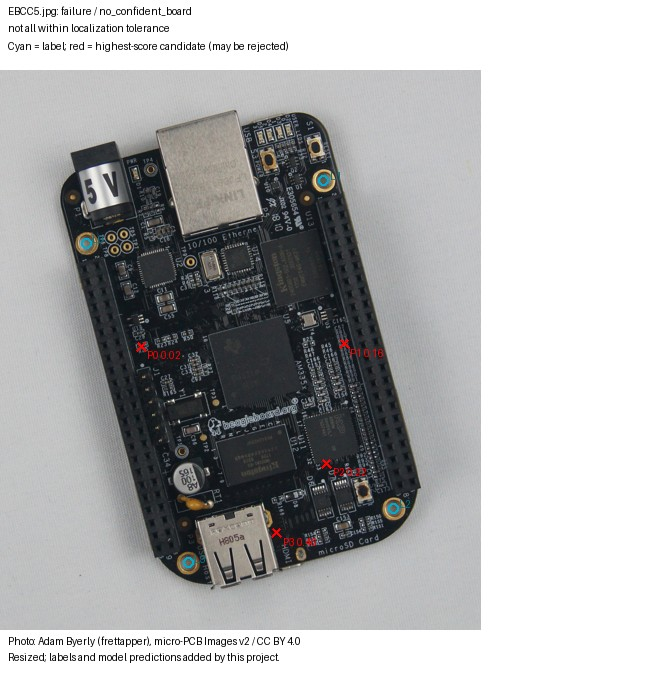
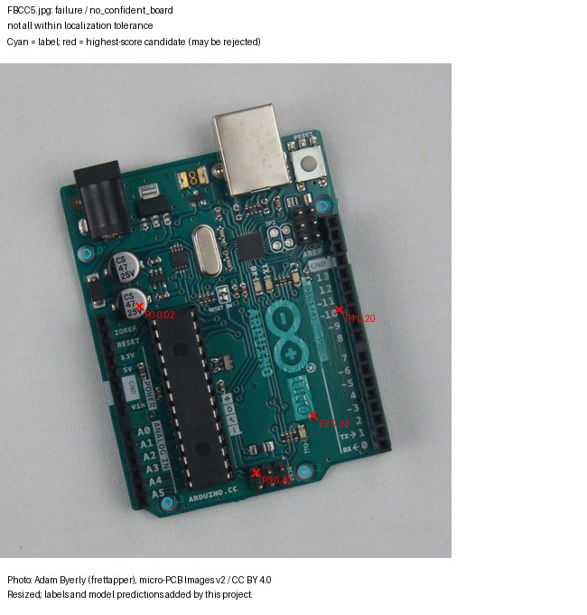

# Step 3 measured results

## Dataset and hardware

Dataset unchanged: 19 train (A/B/H/M), 5 validation (E), 8 held-out (F/K).
All pairs, 17-value class-0 pose rows, box/point ranges, visibility values,
manifest dimensions and layout/family separation passed the automated audit.
128 visible points; zero exact file/decoded-image duplicates across splits.
All 32 contact-sheet views passed physical landmark ordering review. This is
visual review of initial annotations, not independent metrology-quality labels.

Dataset content fingerprint (YAML plus ordered relative image paths, image and
label bytes; text CRLF normalized to LF):
`9fbd4a497e6f714d30a975153a3d4f80750fcc4f42e792edabad77d622abc3c6`.

Windows, CPython 3.10.11, NVIDIA GeForce RTX 3050 6GB Laptop GPU, driver 621.14,
PyTorch 2.9.1+cu128, torchvision 0.24.1+cu128, CUDA runtime 12.8 available.
Ultralytics 8.4.39. See requirements-lock.txt for dependency versions.

## Milestone 1 smoke test

Executed `python -m pcb_landmarks.train --imgsz 320 --epochs 2 --batch 2
--device auto --seed 42 --name smoke_verified` using the project venv.
Both training epochs and validation on all 5 E images completed on CUDA:0.
`runs/landmarks/smoke_verified/weights/best.pt` and `last.pt` were written.
The wrapper exited successfully and wrote `summary.json`.

| Smoke validation metric | Actual value |
|---|---:|
| Pose precision | 0.592720 |
| Pose recall | 0.600000 |
| Pose mAP50 | 0.448333 |
| Pose mAP50–95 | 0.066686 |
| Box mAP50 | 0.030026 |
| Box mAP50–95 | 0.004953 |

These two-epoch metrics only prove execution, not model readiness. The first
attempt trained/validated and wrote weights, but the wrapper reported failure
because Ultralytics resolved its relative output project under `runs/pose`.
Passing an absolute project path fixed that root cause; a regression test and
the fresh `smoke_verified` run verified the correction. Original failed-run
artifacts remain ignored locally for traceability.

Repeated with `--name smoke_clean` after disabling global site-package access
and installing the locked dependencies into the venv: exit 0, identical metrics,
both checkpoints and summary written. `pip check`: no broken requirements.
Three milestone-1 unit tests passed (label contract, split leakage/pairing,
requested checkpoint output location).

## Milestone 2 training and frozen selection

The scheduled run executed on CUDA:0 with official `models/yolo26n-pose.pt`,
image size 640, batch 4, seed 42, deterministic=True, AdamW, lr0=0.001, lrf=0.01,
no flips, AMP off, workers=0, epoch limit 150 and patience 30. Early stopping
completed 89 epochs in approximately 191 seconds; validation fitness selected
epoch 59. No test image selected an epoch or threshold. Run settings, hashes
and initial weight provenance are in `../configs/training.json`.

Checkpoint: `runs/landmarks/full/weights/best.pt` (local, not published).
SHA-256: `3a8646d5b36b417764647751ef029a7af824321e750f0492b61e916124ec7b9e`.
Obtain trained weights by rerunning `STEP3.md`; no public binary hosting was
created. Milestone 1 was pushed as `e1b5a536fabb09141fda97a03aa95022ea7c9b32`
on `origin/docs/pcb-srs-sdd-dfd`.

Validation-only search froze board confidence 0.95 and per-point confidence 0.99
in `../configs/landmarks.json` before held-out evaluation. Policy: minimize
inaccurate accepted images, maximize accurately accepted images, then conservative
confidence ties. The diagnostic tolerance is 1% of image diagonal (about 19–21
validation pixels), not a demonstrated alignment tolerance. **No threshold
candidate yielded an accurately usable validation image. These are rejection-only
settings, not a successful calibration.**

## Evaluation results

Held-out F/K evaluation is **complete**, using the frozen artifact/configuration.
No further training or threshold adjustment used those results.

| Metric | Validation E (5 images) | Held-out F/K (8 images) |
|---|---:|---:|
| Pose precision | 1.000000 | 0.992375 |
| Pose recall | 0.990965 | 1.000000 |
| Pose mAP50 | 0.995000 | 0.995000 |
| Pose mAP50–95 | 0.648333 | 0.639514 |
| Box mAP50–95 | 0.935000 | 0.836750 |
| Matched boards for localization | 5/5 | 8/8 |
| All four landmarks usable at frozen thresholds | 0/5 | 0/8 |
| All four usable and within diagnostic tolerance | 0/5 | 0/8 |
| Images with explicit failed detection | 5/5 | 8/8 |

All runtime failures were `no_confident_board` at 0.95; this does **not** mean
no box existed at lower confidence. Keypoint confidences/localization were also
poor. Box detection worked, but four-point pose is not ready to feed alignment.

| Landmark in dataset order | Validation mean error (pixels) | Held-out mean error (pixels) |
|---|---:|---:|
| upper_left_mount | 232.90 | 234.75 |
| upper_right_mount | 293.28 | 244.11 |
| lower_right_mount | 225.62 | 239.54 |
| lower_left_mount | 246.44 | 310.96 |

Localization matches the highest-confidence prediction with box IoU >= 0.5 and
score >= 0.001, independently of runtime acceptance, and measures Euclidean
error against visibility > 0 labels in full decoded image pixels. Each landmark
has 5 validation and 8 held-out matches. Medians, 95th percentiles, per-image
errors and failure reasons are in [validation JSON](results/val.json) and
[held-out JSON](results/test.json). The broad custom-four-point OKS sigma (0.25
per point) means strong AP cannot establish precise mounting-hole localization.
AP precision/recall come from the library's metric curve; they are not the
operating-point acceptance rate.

Training's final built-in validation reported pose mAP50–95 0.641833. Independent
repeated evaluation at batch 4 reported 0.648333; both actual values are retained.
The original training validation fitness still selected epoch 59.

## Local inference verification and limits

The documented inference CLI ran on ECCC5 with the exact local checkpoint and
frozen config, returned `failure/no_confident_board`, empty landmarks and exit
code 2. A fresh CPU process loaded that checkpoint and inferred on ECCC5 (val),
FCCC5 (held-out) and ACCC5 (train) with DNS/socket connections blocked: **zero
network attempts**. All three returned explicit failure; see
[offline verification JSON](results/offline.json). Generic local human-pose
weights were rejected. Ten focused unit tests and `pip check` pass.

The success JSON contract is tested with synthetic ordered points; no real
complete four-landmark success was observed under frozen settings. Do not
represent this artifact as a verified alignment model. Further training/data/model
investigation is needed before downstream use. Future development needs a new
untouched final evaluation set; F/K results are now known. No homography, overlay
alignment or component comparison was implemented. Physical Wi-Fi-off testing of
a full application, occluded/cropped-landmark evaluation and independent label
accuracy auditing remain pending.

A fresh code review found and verified fixes for: checking the trusted checkpoint
hash before deserialization; stable dataset hashing across Windows line endings;
and rejecting collinear, crossed, mirrored or edge-clipped mounting holes.
Each substantive fix had a failing regression test before implementation; all
ten tests then passed. Board threshold boundary comparisons and configurable
sample captions were aligned too. A validation-only consistency check confirmed
the frozen thresholds remain unchanged; repeated frozen evaluation and blocked
network CPU inference retained the recorded counts. No weights or thresholds
were changed in response to held-out results.

## Publication-cleared examples

Only failures are shown because no qualifying four-landmark success was observed.
Cyan circles are labels; red crosses are the highest-confidence model candidate,
shown for diagnosis even when rejected. Indices retain dataset order.

Additional examples: [ECCB5](samples/val/ECCB5.jpg), [FCCB5](samples/test/FCCB5.jpg).

Photos: Adam Byerly (frettapper), **micro-PCB Images**, Kaggle dataset version 2,
under [CC BY 4.0](https://creativecommons.org/licenses/by/4.0/), as recorded in
Step 2 README/manifest. [Source](https://www.kaggle.com/datasets/frettapper/micropcb-images).
Changes: resizing, annotation marks, prediction marks and diagnostic text.
No new raw photos or labels, caches, credentials, personal paths or bulk training
outputs were added to the public repository.
