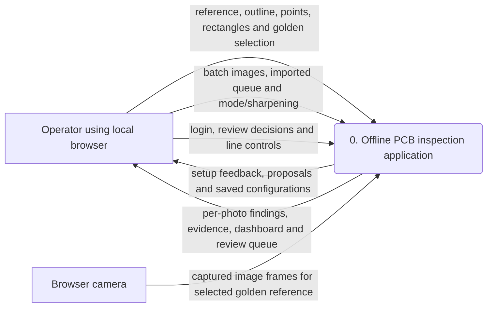
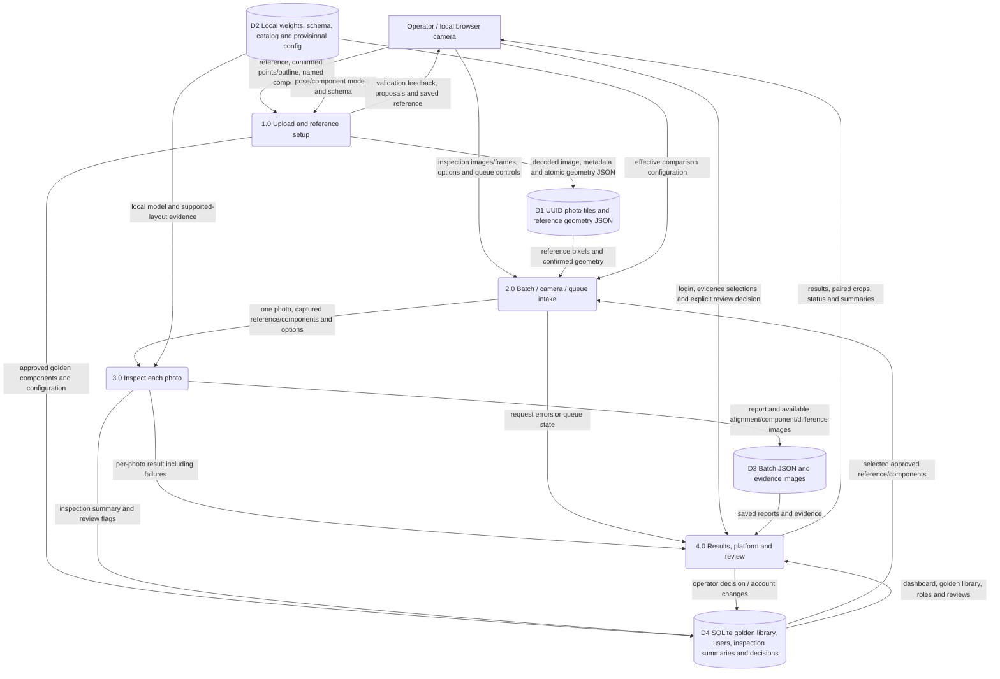
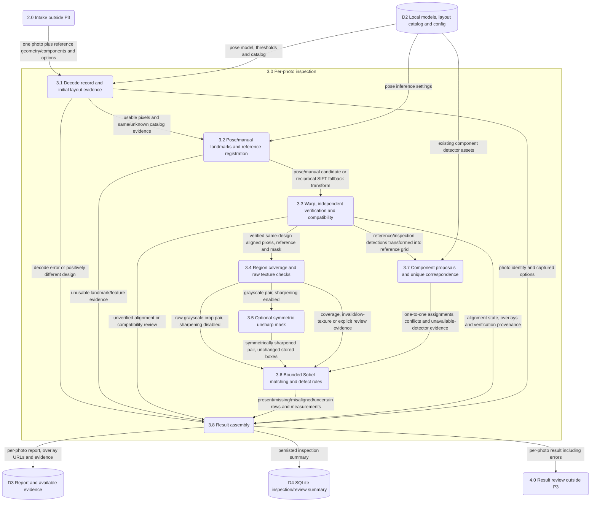

# Data Flow Diagrams

- **Project:** Offline PCB Component Inspection — Task B, “Which Part Is Missing?”
- **Author:** Indraneel Chatterjee
- **Version:** 2.0 — 24 November 2026
- **Status:** Current source-audited flows; performance/acceptance remains provisional. No runtime changes or new test execution.

Related documents: [Software Requirements Specification](SRS.md) · [Software Design Document](SDD.md).

## 1. Notation and shared contract

Mermaid rectangles are external entities, rounded nodes are processes and cylinders are local stores. Arrows name transferred data; process numbers do not prescribe timing. Online installation/training/building occurs outside the runtime boundary. Runtime uses local assets/models and has no cloud inference dependency.

The operator confirms a reference's four ordered points and separate PCB outline, reviews/edits component rectangles and selects a golden configuration. Reference geometry is file-backed; golden components/configuration and platform records are in SQLite. The lab batch API accepts **1–15 photos**, one reference ID, component annotations, mode and sharpening flag. Imported queue chunks also accept 1–15 images; camera frames use the selected reference. Software line simulation and synthetic edits are labeled separately from real defect evidence.

Coordinates are decoded original reference pixels, with integer half-open rectangles. Non-normalized EXIF orientation is rejected. The inspection warp maps into the reference grid; local comparison can search bounded translations/rotation hypotheses without moving saved rectangles. Optional symmetric sharpening defaults off. Actual outcomes are `ok`, `defect`, `review`, `error`, `DIFFERENT_BOARD`; component states include `misaligned` and `not_evaluated`. See [SRS result contract](SRS.md#3-terms-and-result-rules).

## 2. Level 0 — context

## 3. Level 1 — system decomposition

`web.py` orchestrates these flows. Platform operations apply their route-specific authentication/role checks; the local inspection lab is not described as a fully authenticated production API.

D1/D3 default to `runs/web/photos` and `runs/web/batches`; D4 is `runs/web/aoi.db`. `PCB_WEB_STORAGE` changes that root. D2 contains checked-in configuration and prepared local assets; not every configuration is calibrated. Reference setup JSON is atomically replaced, SQLite changes are transactional, and batch reports/images are separate writes. These are implemented stores, not a proposed file-only database design.

## 4. Level 2 — decomposition of P3 inspection

### 4.1 Process notes

- **3.1:** Corrupt uploads retain explicit photo errors. Supported catalog mismatch blocks scoring. Unknown catalog identity does not automatically imply wrong layout; active-reference verification may still succeed.
- **3.2–3.3:** Automatic mode can verify pose candidates against distributed on-board reciprocal SIFT matches, then fall back to reference-feature homography estimation when pose inference fails. Every third correspondence is withheld from fitting in the fallback path. Manual geometry can be refined when independent evidence improves it. The accepted warp has reference-grid pixels and full bilinear-support mask. Independent reprojection, coverage and stable-edge checks qualify registration; four fitted points alone are insufficient evidence.
- **3.4–3.5:** Full region coverage and raw texture checks precede verdicts. Enabled sharpening uses amount 0.5, Gaussian kernel 7×7, sigma 1 on both grayscale inputs; disabled goes directly to matching. Sharpening does not rescue low-texture crops or change stored rectangles.
- **3.6–3.7:** Bounded translation and −30° to +30° rotation hypotheses supplement Sobel normalized correlation. Low similarity requires corroborating absence evidence before `missing`; displacement/rotation can become `misaligned`. Existing detector assignments are corroborating/conflict evidence, not automatic presence or ground truth. Invalid/ambiguous/local unreliable regions remain reviewable.
- **3.8:** Any missing/misaligned part produces `defect` with review required, preserving uncertain rows. Uncertainty produces `review`; all present can yield `ok`. Different-board/error/blocked paths have no valid presence verdicts. Per-photo handling allows other batch photos to continue; malformed shared requests may fail before that loop. Operator decisions are stored separately from machine findings.

### 4.2 Boundary balancing and limits

| Parent flow | Child preservation |
| --- | --- |
| Operator setup and feedback | P1 receives reference geometry/components; D1 and D4 persist their separate portions; feedback returns to operator |
| Batch/camera/queue input | P2 provides a per-photo reference/options snapshot to 3.1 |
| Local model/configuration | D2 supplies schema/catalog/thresholds and existing detectors; no cloud entity is added |
| P3 result and evidence | 3.8 writes D3, persists the summary to D4 and returns the result to P4 |
| Review and account changes | P4 reads stored records and persists explicit authorized platform changes |

The diagrams describe source behavior, not a guarantee of broad-layout recognition, calibrated blur detection, real missing-part accuracy, complete model version provenance or production security. [SRS traceability](SRS.md#41-source-audited-traceability) names existing tests without claiming a fresh run. Historical evidence is indexed in [docs/README](../README.md).
